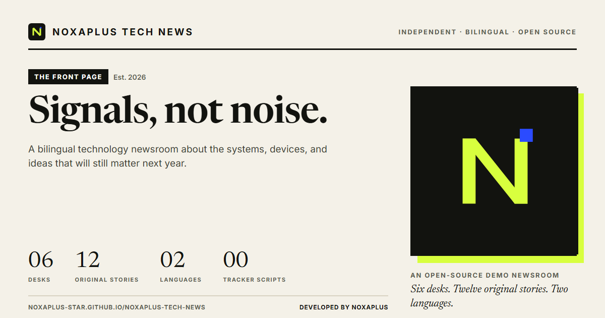

# NoxaPlus Tech News

**Signals, not noise.** A bilingual, open-source technology newsroom template — designed and developed by [NoxaPlus](https://www.noxaplus.ir).

[Live demo](https://noxaplus-star.github.io/noxaplus-tech-news/) · [Report an issue](https://github.com/noxaplus-star/noxaplus-tech-news/issues) · [MIT License](LICENSE)



NoxaPlus Tech News is a complete static editorial site: twelve original bilingual stories across six desks, article pages with tables of contents and takeaways, search with Persian-aware matching, a private reading list, RSS, structured data, generated cover art, and offline support. It needs no framework, no npm install, and no build step — just open the folder on any static host.

> **Demo content notice.** Every story, date, and byline in this repository is an original editorial sample written for the template. Nothing here is live reporting, advice, or a record of real events. Replace `assets/data/news.js` with your own content before publishing.

---

## Highlights

- **Bilingual by design** — complete English and Persian interfaces, RTL layout, Persian numerals, Jalali dates, and a self-hosted Vazirmatn typeface. Language is remembered in `localStorage`.
- **Editorial identity** — paper-and-ink light theme, a real dark theme, serif display type, hard-edged cards, a live ticker, and an asymmetric front page.
- **Seven real pages** — front page, article, desk/category, search, bookmarks, about, and a 404, all sharing one masthead and footer.
- **Search that understands Persian** — normalises Arabic/Persian variants (`ي`/`ی`, `ك`/`ک`), strips diacritics, and highlights matches safely in both languages.
- **Private reading list** — bookmarks live only in the browser; no account, no sync, no tracking.
- **Working offline mode** — a service worker precaches the shell, fonts, covers, and editorial data, with stale-while-revalidate updates.
- **Installable PWA** — manifest, maskable icons, app shortcuts, and theme colours.
- **SEO and sharing built in** — per-page titles, descriptions, canonicals, Open Graph/Twitter cards, thirteen generated social images, JSON-LD (`WebSite`, `Organization`, `BlogPosting`, `BreadcrumbList`, `CollectionPage`), `sitemap.xml`, `robots.txt`, and an RSS feed.
- **Zero runtime dependencies** — local fonts, generated SVG artwork, no analytics, no CDN, and no third-party requests.
- **Accessible foundation** — skip link, landmarks, visible focus, keyboard-operable drawers, live-region toast, reduced-motion support, and print styles.

---

## Quick start

There is no install and no build. Serve the repository root with any static server:

```bash
# Python 3
python -m http.server 4173

# or Node
npx serve .
```

Then open <http://127.0.0.1:4173/>. Opening `index.html` directly via `file://` also renders the site; the service worker is skipped outside HTTP as expected.

To regenerate the artwork and feeds after editing content:

```bash
node scripts/covers.mjs     # 12 deterministic SVG covers
node scripts/render.mjs     # PWA icons + 13 Open Graph PNGs (headless Chrome)
node scripts/feeds.mjs      # sitemap.xml, feed.xml, robots.txt
node scripts/check.mjs      # static validation, no dependencies
```

> `scripts/render.mjs` and `scripts/test-ui.mjs` use a locally installed Chrome or Edge. All other scripts require only Node.js 18+.

---

## Project structure

```
noxaplus-tech-news/
├── index.html                 # Front page shell
├── article.html               # Article shell (?slug=…)
├── category.html              # Desk shell (?c=…&sort=…)
├── search.html                # Search shell (?q=…&c=…)
├── bookmarks.html             # Reading list shell
├── about.html                 # Editorial statement and credits
├── 404.html                   # Not-found page
├── style.css                  # Design system, components, RTL, print
├── app.js                     # Router, rendering, i18n, interactions
├── sw.js                      # Offline shell and runtime caching
├── manifest.webmanifest       # Installable app metadata
├── feed.xml / sitemap.xml     # Generated feeds
├── robots.txt
├── assets/
│   ├── data/news.js           # The entire editorial data layer
│   ├── covers/                # 12 generated SVG covers
│   ├── fonts/                 # Self-hosted WOFF2 files
│   ├── icons/                 # Favicon, app icons, maskable icon
│   └── og/                    # Default + per-story social cards
├── scripts/                   # Node-only generators and checks
├── docs/                      # Customization and deployment guides
└── .github/workflows/         # CI validation and Pages deployment
```

### URL routing

| Page | URL | Indexed |
| --- | --- | --- |
| Front page | `/` or `/index.html` | Yes |
| Story | `/article.html?slug=small-models-big-shift` | Yes |
| Desk | `/category.html?c=ai&sort=oldest` | Yes |
| Search | `/search.html?q=battery&c=mobile` | `noindex,follow` |
| Reading list | `/bookmarks.html` | `noindex,follow` |
| About | `/about.html` | Yes |
| Missing page | `/404.html` | `noindex,nofollow` |

All page shells are static; `app.js` reads query parameters and renders into `#page`. This keeps GitHub Pages hosting simple and avoids a server.

---

## The editorial data model

Everything lives in [`assets/data/news.js`](assets/data/news.js): `site`, six `categories`, three `authors`, and twelve `articles`. A story looks like this:

```js
{
  slug: 'small-models-big-shift',
  category: 'ai',
  author: 'editorial',
  date: '2026-11-11',
  featured: true,
  trending: 1,
  cover: 'assets/covers/ai-small-models.svg',
  readMins: { en: 7, fa: 6 },
  title: { en: '…', fa: '…' },
  dek: { en: '…', fa: '…' },
  tags: [{ en: 'On-device AI', fa: 'هوش مصنوعی روی دستگاه' }],
  takeaways: { en: ['…'], fa: ['…'] },
  body: [
    { type: 'p', en: '…', fa: '…' },
    { type: 'h2', en: '…', fa: '…' },
    { type: 'quote', en: '…', fa: '…', citeEn: '…', citeFa: '…' },
    { type: 'list', en: ['…'], fa: ['…'] }
  ]
}
```

**To add a story:** append an object at the top of `ARTICLES` (newest first), add a cover, run `node scripts/render.mjs` and `node scripts/feeds.mjs`, then `node scripts/check.mjs`. The validator checks slugs, bilingual fields, dates, categories, bylines, covers, social images, feeds, and precache entries.

---

## How the bilingual system works

- `state.lang` is `en` or `fa`; it is stored under `noxa_lang`.
- The `<html>` element receives `lang`, `dir`, and `data-lang`. CSS uses `html[lang='fa']` for typography and spacing refinements.
- Interface strings live in the `UI` dictionary in `app.js`; content strings live in `news.js`.
- Dates use `Intl` with `fa-IR-u-ca-persian` for Jalali output; numbers use Persian digits in Persian mode.
- Every render path reads `state.lang`, so switching language re-renders the header, page, footer, meta tags, and JSON-LD without a reload.

## Theme system

The light theme is warm paper and ink with a lime accent; the dark theme keeps the same hierarchy with a near-black canvas. The choice is saved as `noxa_theme`. A tiny inline script in every page applies the stored theme before paint to avoid a flash. `prefers-color-scheme` is respected on first visit, and `theme-color` updates for mobile browsers.

## Offline and install

`sw.js` precaches the seven shells, CSS, JS, data, four fonts, twelve covers, icons, and the default social card. Navigations are network-first with an offline shell fallback; static assets are stale-while-revalidate. Bump `VERSION` when shipping asset changes. The manifest exposes Latest, Search, and Saved shortcuts.

## SEO and structured data

`updateDocumentMeta()` maintains title, description, robots, canonical, Open Graph, Twitter, and theme colour per route. Article pages emit `BlogPosting` + `BreadcrumbList`; the home page emits `WebSite` + `Organization`; desks emit `CollectionPage`. Search and bookmarks are intentionally excluded from indexing and from the sitemap. `scripts/feeds.mjs` generates a 20-URL sitemap and a 12-item RSS feed from the same data.

---

## Validation

```bash
node scripts/check.mjs
```

The static suite verifies required files, bilingual completeness, unique slugs and dates, category/byline integrity, cover and social-image existence, HTML shells and metadata, local links, manifest icons, service-worker precache coverage, sitemap/feed counts, MIT licensing, and placeholder leakage. It is dependency-free and runs in CI.

A browser smoke test is included for local use:

```bash
# 1. serve the site on port 4173
# 2. launch Chrome with remote debugging
chrome --headless=new --remote-debugging-port=9222 --user-data-dir=/tmp/noxa-cdp about:blank
# 3. run the suite
node scripts/test-ui.mjs
```

It covers English/Persian switching, RTL and Persian numerals, dark mode, article rendering and JSON-LD, bookmarks, desk sorting, search highlighting, the newsletter demo, the 404 route, mobile layout and drawer, PWA/manifest/feed presence, console cleanliness, and screenshots in `.preview/`.

---

## Deployment

Push to `master`; the included workflow uploads the repository root as a Pages artifact and deploys it. Enable **Settings → Pages → Source: GitHub Actions** once. Details, custom domains, and cache notes are in [docs/deployment.md](docs/deployment.md).

## Customization

Branding, colours, fonts, categories, the data schema, cover generation, social cards, and the service-worker version are covered in [docs/customization.md](docs/customization.md). Community expectations are in [CONTRIBUTING.md](CONTRIBUTING.md); security reports go to the address in [SECURITY.md](SECURITY.md).

## Browser support

Current Chrome, Edge, Firefox, and Safari. The site uses modern CSS (`color-mix`, logical properties, `clamp`) and vanilla ES5-compatible JavaScript. Without JavaScript, the noscript panel explains the demo and links to the raw data; the `feed.xml` archive remains readable in any feed reader.

## License

Released under the [MIT License](LICENSE). You may use, modify, and redistribute the template, including commercially, provided the copyright notice is retained.

---

**Developed by NoxaPlus** — an independent studio building open-source tools and editorial experiments.

- Website: [www.noxaplus.ir](https://www.noxaplus.ir)
- Email: [NoxaPlus2025@gmail.com](mailto:NoxaPlus2025@gmail.com)
- Phone: 09198690446
- Source: [github.com/noxaplus-star/noxaplus-tech-news](https://github.com/noxaplus-star/noxaplus-tech-news)
